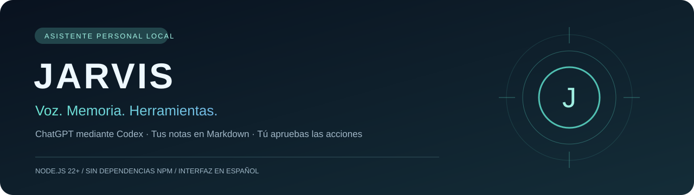
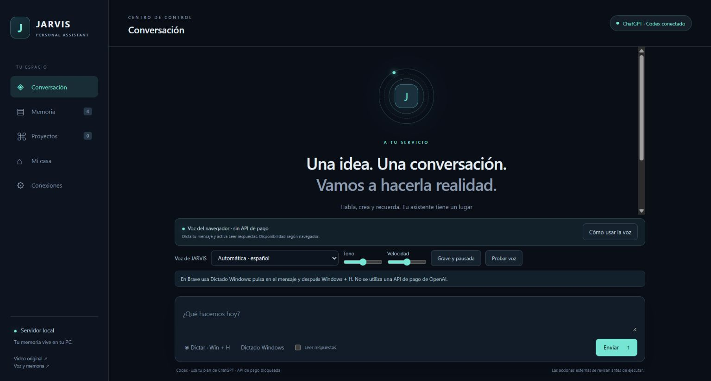
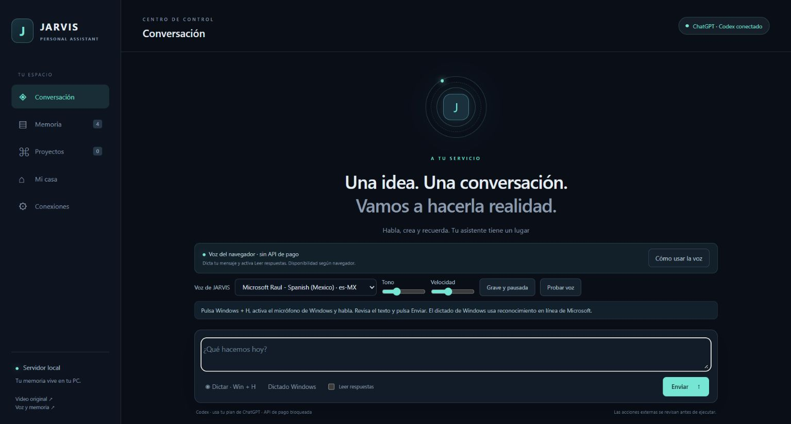
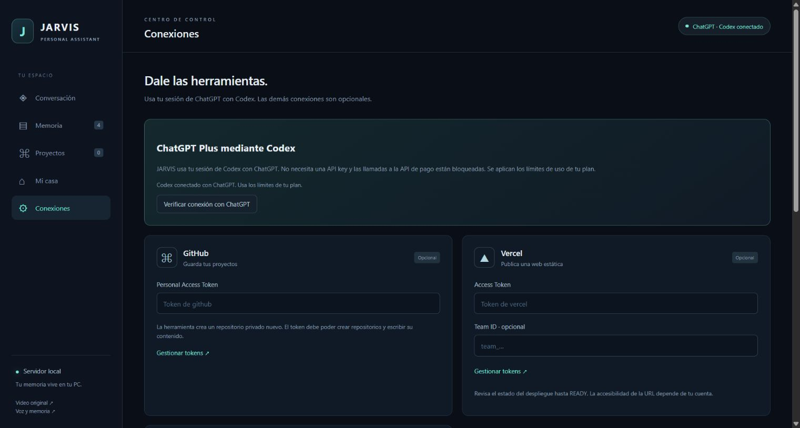

<p align="center"></p>

<p align="center"><strong>Tu asistente local en español, con una memoria que puedes editar.</strong><br>ChatGPT mediante Codex · Node.js 22+ · Sin dependencias npm</p>

<p align="center"><a href="#empezar">Empezar</a> · <a href="docs/USO.md">Guía de uso</a> · <a href="docs/ARQUITECTURA.md">Arquitectura</a> · <a href="docs/VOZ.md">Voz y dictado</a> · <a href="docs/PROBLEMAS.md">Solución de problemas</a></p>

JARVIS Personal reúne conversación, notas Markdown, creación de webs estáticas y herramientas opcionales en un panel que se ejecuta en tu PC. El motor utiliza **Codex CLI con inicio de sesión de ChatGPT**. La configuración de esta versión bloquea la API de pago de OpenAI y Realtime: no necesitas introducir una API key para conversar.

Se aplican los límites de Codex incluidos en tu plan de ChatGPT. No se promete uso ilimitado ni funcionamiento sin conexión: las peticiones al modelo se envían a OpenAI. Si se agota el uso disponible, espera a su renovación; no hay un cambio automático a la API de pago.



## Qué puedes hacer

| Función | Comportamiento |
| --- | --- |
| Conversación | Respuestas en español mediante la sesión de ChatGPT de Codex. |
| Memoria editable | Identidad, perfil, estilo y notas en Markdown, compatibles con Obsidian. |
| Contexto selectivo | Búsqueda por palabras y fragmentos limitados; muestra qué memoria se consultó. |
| Voz | Lectura con voces del sistema/navegador, tono y velocidad configurables. |
| Dictado | Reconocimiento del navegador cuando funciona; alternativa Windows + H en Brave. |
| Proyectos | Crea y revisa archivos HTML, CSS, JS, JSON, Markdown, TXT y SVG. |
| Clima | Consulta geocodificación y previsión de tres días mediante Open-Meteo. |
| Publicación opcional | Prepara un repositorio privado nuevo en GitHub o un despliegue estático en Vercel. |
| Domótica opcional | Luces, interruptores y escenas autorizadas de Home Assistant. |
| Revisión de acciones | Publicaciones y cambios en dispositivos requieren aprobación de una tarjeta. |

Este repositorio público contiene **la aplicación**, su documentación y capturas de una instalación limpia. La herramienta interna de GitHub está destinada a publicar **proyectos estáticos creados en JARVIS**, y crea repositorios privados; son dos operaciones diferentes.

## Empezar

### Requisitos

- Node.js 22 o superior.
- Un ejecutable oficial de Codex CLI instalado y una sesión iniciada con ChatGPT.
- Un plan/cuenta con acceso a Codex y uso disponible.
- Internet para conversar y consultar servicios externos.

El entorno comprobado es Windows con Node.js 24.19.0 y el ejecutable de Codex incluido en la aplicación de escritorio. Consulta [instalación y autenticación](docs/INSTALACION.md) para otros equipos y para configurar la ruta del ejecutable.

```powershell
git clone https://github.com/Nightdxs/jarvis-personal.git
cd jarvis-personal
```

Comprueba tu sesión con `codex login status`, usando el ejecutable instalado. Debe indicar `Logged in using ChatGPT`. Si necesitas iniciar sesión, usa `codex login` y elige ChatGPT.

En Windows, ejecuta **Iniciar-JARVIS.cmd** y abre **http://localhost:8787/**. Mantén abierto el proceso del servidor mientras utilizas JARVIS. No necesitas ejecutar `npm install`.

Desde PowerShell también puedes usar:

```powershell
$env:JARVIS_NO_PAID_API = '1'
npm start
```

En **Conexiones**, pulsa **Verificar conexión con ChatGPT**. Vuelve a **Conversación** y envía tu primera petición:

> Ayúdame a definir mi perfil. Pregúntame mis objetivos y preferencias y guarda las respuestas en mi memoria.

## Hablar y cambiar la voz

1. Selecciona **Voz de JARVIS** y pulsa **Probar voz**.
2. Ajusta **Tono** y **Velocidad**, o pulsa **Grave y pausada**.
3. Marca **Leer respuestas**.
4. Pulsa **Dictar**, habla y revisa el texto antes de pulsar **Enviar**.
5. En Brave, pulsa **Dictar · Win + H** y después **Windows + H** para usar el dictado de Windows.

La selección se guarda en ese navegador. La voz exacta de JARVIS de Marvel no está incluida; el ajuste grave y pausado modifica una voz instalada. No hay palabra de activación, escucha permanente ni conversación de audio Realtime en este modo. El dictado puede enviar audio al proveedor de reconocimiento del navegador o a Microsoft si usas Windows. Consulta [la guía de voz](docs/VOZ.md).



## Conexiones y privacidad

GitHub, Vercel y Home Assistant son opcionales. Sus tokens se introducen en el panel local y permanecen en memoria del servidor; no se escriben en notas ni en el repositorio. Al cerrar el proceso se pierden. Codex gestiona su propio inicio de sesión: JARVIS no copia su almacén de autenticación.

La memoria y el historial se guardan en tu equipo, pero los fragmentos seleccionados y la conversación se envían al modelo para responder. **Local no significa completamente offline.** Las carpetas `vault/`, `projects/` y `data/` se crean al arrancar y están excluidas de Git. Consulta [seguridad y flujo de datos](SECURITY.md).



## Documentación

| Guía | Contenido |
| --- | --- |
| [Instalación](docs/INSTALACION.md) | Requisitos, ruta de Codex, arranque y acceso privado remoto. |
| [Uso diario](docs/USO.md) | Conversación, memoria, proyectos, clima y aprobaciones. |
| [Voz](docs/VOZ.md) | Dictado, Windows + H, voces, tono y velocidad. |
| [Integraciones](docs/INTEGRACIONES.md) | GitHub, Vercel, Home Assistant y límites de Alexa. |
| [Arquitectura](docs/ARQUITECTURA.md) | Módulos, flujo de herramientas, almacenamiento y rutas HTTP. |
| [Problemas frecuentes](docs/PROBLEMAS.md) | Error network, sesión de Codex, puerto y permisos. |
| [Validación](docs/VALIDACION.md) | Qué se probó realmente y qué utiliza simulaciones. |
| [Referencias](docs/REFERENCIAS.md) | Los dos videos y documentación de proveedores. |
| [Contribuir](CONTRIBUTING.md) | Cómo editar, probar y proponer cambios. |
| [Historial](CHANGELOG.md) | Evolución de la aplicación. |

## Pruebas

```powershell
npm test
```

La suite tiene **19 pruebas**. Los servicios externos se simulan en las pruebas automatizadas; no crean repositorios, despliegues ni acciones físicas. Se comprobaron también una respuesta real mediante ChatGPT/Codex, el listado de notas y la consulta de clima. El audio del micrófono y las integraciones opcionales necesitan validación en cada instalación. [Detalles de validación](docs/VALIDACION.md).

## Alcance

La aplicación crea webs estáticas y trabaja con sus carpetas autorizadas. No ejecuta comandos generados por el modelo, no compila frameworks ni controla todo el ordenador. Home Assistant requiere dispositivos configurados; no existe acceso directo a una cuenta Alexa. La interfaz móvil no convierte `localhost` en una dirección accesible desde otro equipo.

Proyecto independiente inspirado en los tutoriales enlazados. No está afiliado a Marvel ni utiliza sus recursos audiovisuales. No se ha asignado una licencia de reutilización; consulta al titular antes de redistribuir el código.
