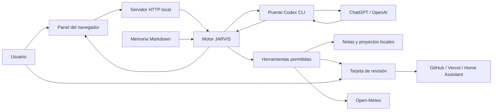

# Arquitectura y referencia técnica

[Volver al inicio](../README.md)

## Flujo principal

El modelo solicita herramientas en JSON; el motor valida y ejecuta las permitidas. Los resultados se devuelven al modelo antes de responder. Las escrituras locales permitidas no tienen una tarjeta externa; publicaciones y acciones sobre dispositivos sí la tienen.

## Módulos

| Archivo | Responsabilidad |
| --- | --- |
| `server.mjs` | HTTP, sesión, protección de origen, recursos y API del panel. |
| `core.mjs` | Estado, conversación, herramientas, credenciales en memoria y aprobaciones. |
| `codex-bridge.mjs` | Detección del CLI, estado de autenticación y respuesta estructurada. |
| `memory.mjs` | Búsqueda lexical, selección de fragmentos e historial acotado. |
| `files.mjs` | Rutas autorizadas, extensiones y rechazo de enlaces simbólicos. |
| `public/app.js` | Panel, tarjetas, dictado, voces y controles de usuario. |
| `public/realtime.js` | Implementación anterior de WebRTC; bloqueada en el modo actual. |
| `tests/*.test.mjs` | Pruebas automatizadas del motor, servidor y puente. |

## Puente de Codex

El proceso se lanza directamente con `spawn`, `shell: false`, stdin para el prompt y ventana oculta en Windows. Usa un esquema `{ text, calls: [{ name, arguments }] }`, donde `arguments` es una cadena JSON.

Opciones principales: `exec --json --ephemeral --ignore-user-config --skip-git-repo-check --sandbox read-only`. Deshabilita `shell_tool`, `unified_exec` y `multi_agent`; fuerza `forced_login_method="chatgpt"` y `web_search="disabled"`. La app rechaza eventos de herramientas nativas fuera de los mensajes y razonamiento esperados. No ejecuta comandos generados por el modelo.

Se eliminan del entorno del proceso de Codex `OPENAI_API_KEY`, `CODEX_API_KEY`, `CODEX_ACCESS_TOKEN` y `OPENAI_BASE_URL`. El CLI gestiona su autenticación propia. El estado se cachea durante 60 segundos; Verificar conexión fuerza una nueva comprobación. El timeout de respuesta es de 180 segundos. Una versión de CLI incompatible puede requerir actualizar la instalación o adaptar el puente.

## Estado y límites

| Recurso | Límite de implementación |
| --- | --- |
| Memoria inicial | 6.000 caracteres; configuración admitida entre 2.500 y 12.000. |
| Historial enviado | Hasta 16 entradas recientes y presupuesto de 12.000 caracteres. |
| Historial guardado | Últimas 60 entradas. |
| Lectura parcial de nota | 12.000 caracteres por bloque. |
| Nota escrita | Hasta 100.000 caracteres. |
| Archivo de proyecto escrito | Hasta 250.000 caracteres. |
| Publicación | Hasta 60 archivos y 2 MB de la copia serializada. |
| Acciones pendientes | Hasta 20, con caducidad de 30 minutos. |
| Petición HTTP JSON | Hasta 1 MB. |

Son límites de datos, no garantías sobre tokens consumidos ni el uso restante del plan. La selección lexical no carga indiscriminadamente todas las notas en el contexto.

## Herramientas

Memoria: `list_notes`, `search_notes`, `read_note`, `write_note`. Proyectos: `list_projects`, `read_project_file`, `write_project_file`. Servicios: `publish_github`, `deploy_vercel`, `deployment_status`, `list_devices`, `control_device`, `get_weather`.

## Rutas HTTP

Todas las rutas de datos necesitan la sesión del panel. Las escrituras requieren JSON, origen autorizado y cabecera `X-Jarvis: 1`. El origen debe incluir el puerto real. No es una API pública con autenticación por bearer token.

| Método | Ruta | Uso |
| --- | --- | --- |
| GET | `/api/access` | Estado del bloqueo de acceso. |
| POST | `/api/login` | Código privado cuando se configura acceso remoto. |
| GET | `/api/state` | Estado, notas, proyectos y conexiones sin claves. |
| POST | `/api/chat` | Mensaje `{ "message": "..." }`. |
| POST | `/api/verify-codex` | Comprueba el inicio de sesión con ChatGPT. |
| POST | `/api/settings` | Actualiza ajustes y tokens en memoria. |
| GET / POST | `/api/note` | Lee por `?file=...`; escribe con `file` y `content`. |
| GET | `/api/project-file` | Lee por `?project=...&file=...`. |
| POST | `/api/action` | Solicita una herramienta admitida con `tool` y `args`. |
| POST | `/api/approve` | Resuelve `{ "id": "...", "allowed": true }`. |
| GET | `/api/review-files` | Copia revisable por `?id=...`. |
| GET | `/preview/...` / `/review/...` | Vistas de proyectos y copias preparadas. |
| POST | `/api/clear-history` | Vacía conversación, conserva notas/proyectos. |
| POST | `/api/disconnect` | Limpia tokens de la aplicación. |

Las rutas `/api/realtime/*` y `/api/verify-key` se conservan por compatibilidad con el código anterior. Realtime y el chat de pago están bloqueados en la configuración de esta versión; no forman parte del flujo recomendado.
