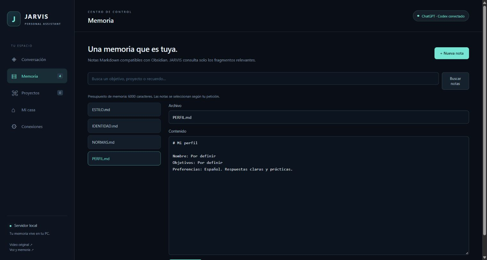

# Guía de uso

[Volver al inicio](../README.md)

## Conversación

Escribe tu petición y pulsa Enviar. Enter envía; Shift + Enter añade una línea. El panel muestra progreso, respuesta y herramientas utilizadas. Espera a que finalice una petición antes de iniciar otra.

Ejemplos:

- «Pregúntame mis objetivos y guarda mi perfil».
- «Recuerda que prefiero respuestas cortas en español».
- «Busca en mi memoria las ideas sobre mi cafetería».
- «Crea una landing responsive en el proyecto mi-web y muéstrame la vista previa».
- «Consulta el clima de Lima, Perú».

La respuesta solo confirma una acción cuando existe un resultado de herramienta. Una propuesta del modelo no equivale a una acción ejecutada.

## Memoria

El primer arranque crea cuatro notas en `vault/`:

| Archivo | Contenido |
| --- | --- |
| `IDENTIDAD.md` | Personalidad y forma de responder. |
| `PERFIL.md` | Objetivos y preferencias del usuario. |
| `ESTILO.md` | Preferencias para diseño de webs. |
| `NORMAS.md` | Reglas sobre secretos, verificación y aprobaciones. |

En Memoria puedes abrir, editar, guardar y buscar notas. También puedes abrir `vault/` como bóveda de Obsidian. No necesitas Obsidian para que JARVIS funcione.

La búsqueda compara palabras normalizadas sin acentos. No es una base de embeddings. El contexto inicial usa normas, identidad y perfil; incorpora estilo cuando detecta una tarea de diseño y añade fragmentos relevantes. Su presupuesto inicial es 6.000 caracteres. Las notas largas se leen por bloques de hasta 12.000 caracteres. Pedir una nota concreta ayuda si la búsqueda no encuentra el recuerdo.

## Proyectos

JARVIS escribe proyectos estáticos dentro de `projects/`. Usa nombres cortos en minúsculas, números y guiones, empezando por una letra, por ejemplo `mi-web`.

Abre Proyectos para revisar archivos, código y vista previa. El iframe tiene restricciones de sandbox y conexión. Una web que necesita recursos externos puede comportarse de forma distinta en esa vista. No se ejecutan scripts de terminal ni servidores generados por el modelo.

## Revisar acciones

GitHub, Vercel y las acciones sobre dispositivos generan una tarjeta. Revisa su descripción y, para una publicación, pulsa **Revisar archivos preparados**. La tarjeta conserva una copia de los archivos que se enviarán; cambios posteriores en el proyecto no alteran esa copia.

Pulsa Aprobar y ejecutar o Cancelar. Cada acción se consume una sola vez y caduca tras 30 minutos. Guardar nuevas conexiones invalida las acciones pendientes. Para publicar una versión modificada, prepara una nueva tarjeta.

## Clima

Indica ciudad y país para evitar ambigüedades. Se consulta Open-Meteo, con geocodificación y previsión de tres días. La tarjeta muestra fuente, ubicación, hora y unidades; no solicita geolocalización al navegador.

## Reiniciar y conservar datos

Cerrar el servidor conserva los archivos e historial, pero elimina los tokens que estaban únicamente en memoria. **Vaciar conversación** conserva notas y proyectos. **Desconectar claves** limpia los tokens opcionales de la aplicación; no cierra la sesión de ChatGPT del CLI de Codex.
